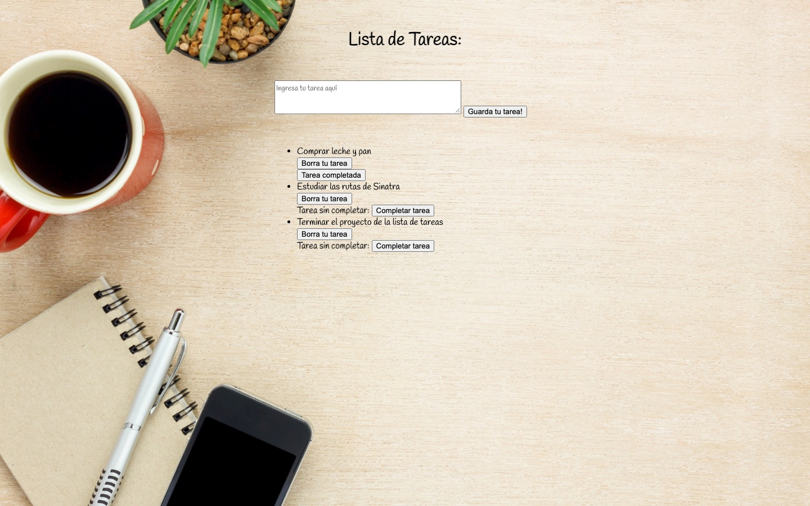

# Lista de Tareas

Proyecto en [Sinatra](https://sinatrarb.com/) para administrar una lista de tareas. Permite:

- Crear una tarea nueva escribiéndola en el formulario.
- Marcar una tarea como completada.
- Borrar una tarea.

Las tareas se guardan usando la gema [`make_todo`](https://rubygems.org/gems/make_todo), que se conecta a una API externa de tareas.

## Capturas de pantalla

Lista vacía:


Lista con tareas, una de ellas completada:



## Instalación

Necesitas tener [Ruby](https://www.ruby-lang.org/es/) instalado. Luego instala las gemas:

```bash
gem install sinatra rackup puma make_todo
```

Para ejecutar la aplicación:

```bash
ruby index.rb
```

Abre http://localhost:4567

> **Nota:** la API que usa la gema `make_todo` (`makeitreal-todo.herokuapp.com`) ya no funciona, así que hoy la aplicación no puede cargar ni guardar tareas. Las capturas se tomaron reemplazando esa API por una lista en memoria.

## Estructura

```
index.rb          rutas de la aplicación
views/layout.erb  plantilla base
views/index.erb   formulario y lista de tareas
public/style.css  estilos
screenshots/      capturas de pantalla
```
